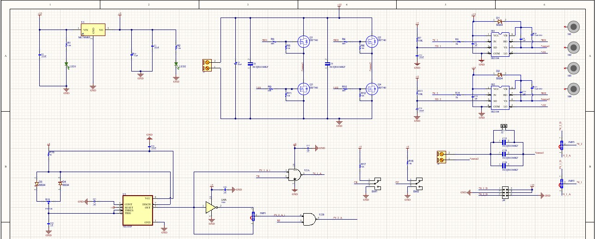
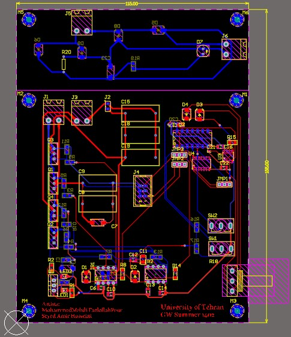

# Hardware Design

This directory contains the **circuit schematic and PCB design files** of the **Resonant Wireless Power Transfer System**. The design combines a MOSFET full-bridge transmitter, analog/digital switching control, resonant magnetic coupling, and a rectified DC output for a motor load.

The schematic and PCB source files are kept **together in the `Hardware/` directory**, without separate `Schematic/` and `PCB/` folders.

## Circuit Schematic

  

<strong>Figure 1. Wireless Power Transfer Circuit Schematic</strong>

<em>Electrical design showing the switching, power-conversion, resonant-link, and receiver circuitry.</em>

The schematic design consists of the following functional blocks:

- **Full-bridge inverter:** Four IRF740 power MOSFETs form the transmitter switching stage.
- **Gate drivers:** Two IR2104 devices generate high-side and low-side gate-drive outputs for the bridge legs.
- **Analog control:** An NE555P timer, with associated logic and timing components, provides an adjustable pulse-generation path.
- **Digital control:** An Arduino Uno provides an alternative pulse-generation method.
- **Resonant network:** Coil inductances and selectable capacitive elements determine the electrical tuning of the inductive transfer path.
- **Receiver:** An SS34 diode rectifier and output-filter capacitor convert the received alternating voltage to DC for the load.
- **Auxiliary power:** An MC78M05 regulator provides a 5 V supply rail for supporting circuitry.

> **Engineering note:** The actual resonant frequency and oscillator duty cycle must be verified by component measurements and oscilloscope measurements. The schematic alone does not establish a guaranteed 50% duty cycle or a measured transfer efficiency.

## PCB Design

  

<strong>Figure 2. PCB Layout</strong>

<em>Printed circuit board layout integrating the power-switching stage, control electronics, auxiliary supply, and external interconnections.</em>

The PCB layout implements the schematic connections and provides mounting positions and electrical interconnections for the switching devices, driver ICs, control circuitry, and connectors. The assembled circuit and a 3D PCB visualization are available in the [Images](../Images/) directory.

## Design Files

The original schematic and PCB files are stored directly in this directory. Open the corresponding project files in their compatible EDA software to inspect and edit the circuit and layout.

## Related Resources

- [Technical Report (PDF)](../Report/Resonant_Wireless_Power_Transfer_Technical_Report.pdf)
- [Project Images](../Images/)
- [Hardware Demonstration](../Demonstration/)
