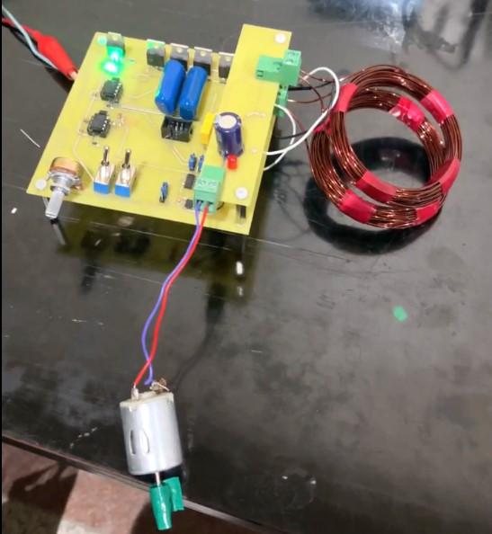
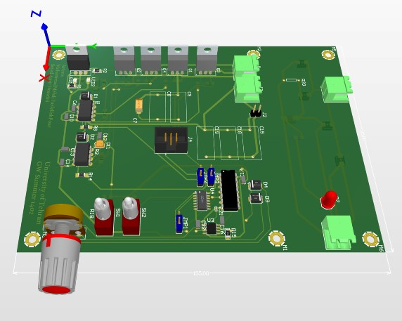
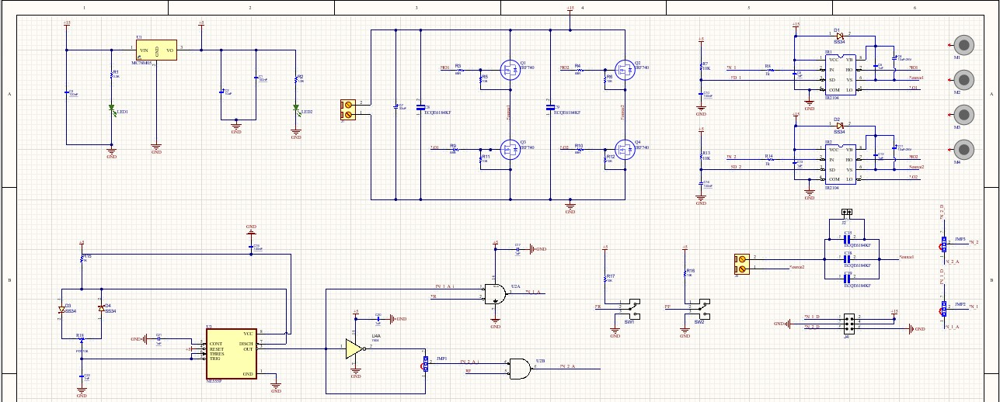
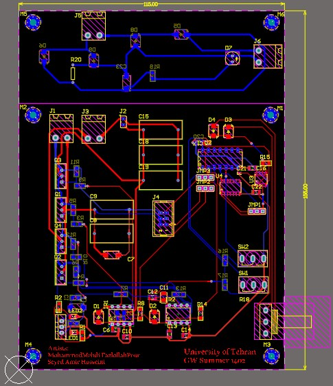

# Project Images

This directory contains visual documentation of the **Resonant Wireless Power Transfer System**, including the circuit schematic, PCB layout, 3D PCB visualization, and assembled hardware.

## Assembled Hardware Prototype

<em>Figure 1. Physical prototype for the wireless power transfer demonstration.</em>

## PCB 3D View

<em>Figure 2. Three-dimensional PCB visualization.</em>

## Circuit Schematic

<em>Figure 3. Circuit schematic documenting the main functional blocks.</em>

## PCB Layout

<em>Figure 4. Printed circuit board layout.</em>

For an explanation of the circuit and PCB, see the [Hardware Documentation](../Hardware/).
