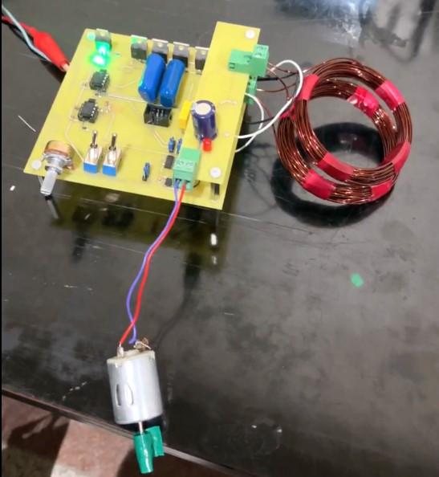
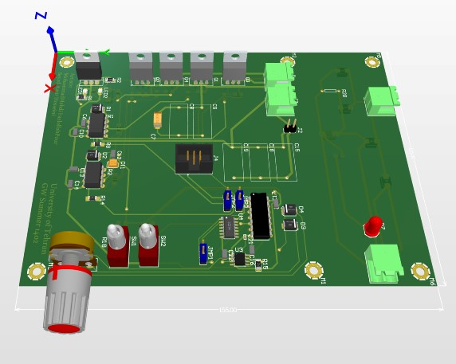
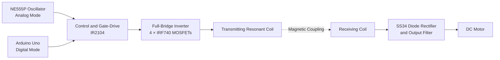

# Resonant Wireless Power Transfer System

  <strong>H-Bridge Power Electronics · Resonant Inductive Coupling · Analog & Digital Control</strong>

## Project Overview

This project presents the design and implementation of a **short-range resonant wireless power transfer (WPT) demonstrator**. A MOSFET-based full-bridge inverter excites a transmitting coil with a switched waveform. Magnetic coupling induces an alternating voltage in a nearby receiving coil; the received signal is then rectified and filtered to supply a **DC motor**.

The transmitter supports two control approaches: an **analog oscillator based on the NE555P timer** and a **digital pulse-generation approach using an Arduino Uno**. The power stage is driven through **IR2104 half-bridge gate-driver ICs**.

## Hardware Prototype

  

<strong>Figure 1. Assembled Hardware Prototype</strong>

<em>Physical implementation of the transmitter and receiver circuitry used to demonstrate wireless delivery of electrical power to a DC motor.</em>

## PCB Design

  

<strong>Figure 2. PCB 3D View</strong>

<em>Three-dimensional visualization of the designed PCB, illustrating component placement and the integration of switching, control, and supporting circuits.</em>

## System Architecture

Only one control mode is intended to provide the drive command at a time; the diagram summarizes the functional signal path rather than the detailed electrical connections.

## Operating Principle

The transmitter converts a DC supply into an alternating excitation by switching an **H-bridge of four IRF740 MOSFETs**. The two IR2104 gate-driver devices provide high-side/low-side drive functions for the bridge legs.

In **analog mode**, an NE555P timing circuit generates the command waveform, with associated logic circuitry conditioning the switching signals. In **digital mode**, an Arduino Uno generates the command waveform instead of the analog timer.

The transmitting and receiving coils form an inductively coupled link. Capacitive tuning can be used to bring the resonant network close to the desired operating frequency, subject to the measured inductance and circuit loading. The receiver employs an **SS34 diode bridge** and a smoothing capacitor to obtain a DC output for the motor.

## Key Components

| Component | Function |
|---|---|
| NE555P | Analog switching-signal generation |
| Arduino Uno | Alternative digital switching-signal generation |
| IR2104 (×2) | High-side and low-side MOSFET gate driving |
| IRF740 (×4) | Full-bridge power switching |
| Coupled coils and tuning capacitors | Resonant wireless energy-transfer link |
| SS34 diodes and filter capacitor | Receiver-side rectification and smoothing |
| MC78M05 | Regulated 5 V auxiliary supply |
| DC motor | Demonstration load |

## Project Files

- **[Hardware Design](Hardware/)** — Circuit schematic, PCB design files, and engineering description.
- **[Project Images](Images/)** — Schematic, PCB layout, PCB 3D view, and prototype photographs.
- **[Hardware Demonstration](Demonstration/)** — Video of the wireless power transfer demonstration.
- **[Technical Report (PDF)](Report/Resonant_Wireless_Power_Transfer_Technical_Report.pdf)** — Complete engineering report and circuit analysis.

## Demonstration

[**Watch the Wireless Power Transfer Demonstration**](Demonstration/Wireless_Power_Transfer_Demo.mp4)

The demonstration illustrates the intended operation of the transmitter–receiver arrangement and a DC motor as the electrical load.

## Validation and Scope

This repository documents a **laboratory-scale engineering demonstrator**. The available project description and schematic images do not establish independently measured values for operating frequency, coil separation, delivered output power, transfer efficiency, or thermal performance. Accordingly, no quantified performance or long-range power-transfer claims are made.

The design is intended for education and engineering study, rather than certified commercial wireless-power operation.
